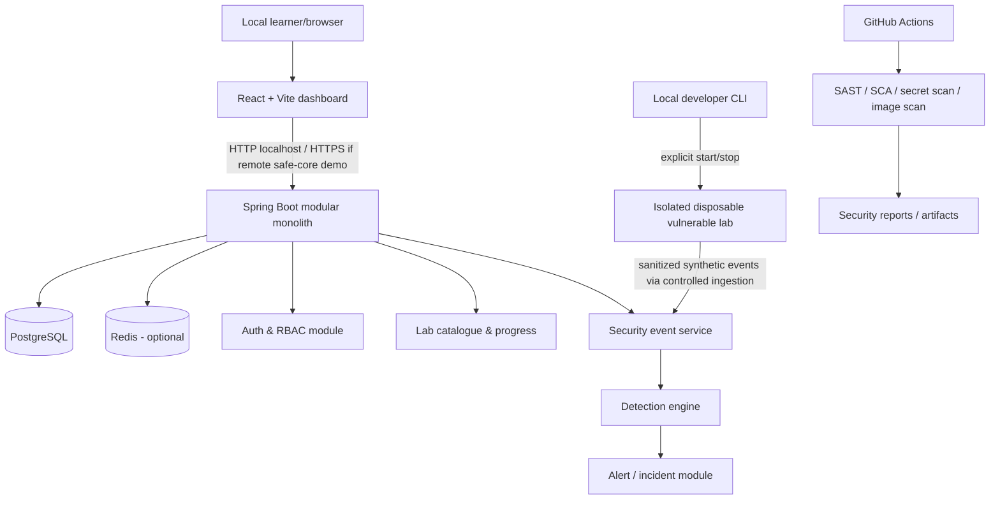
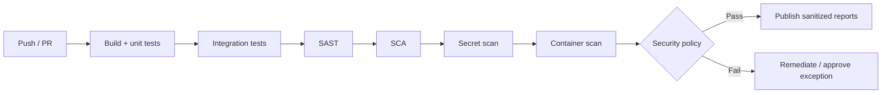
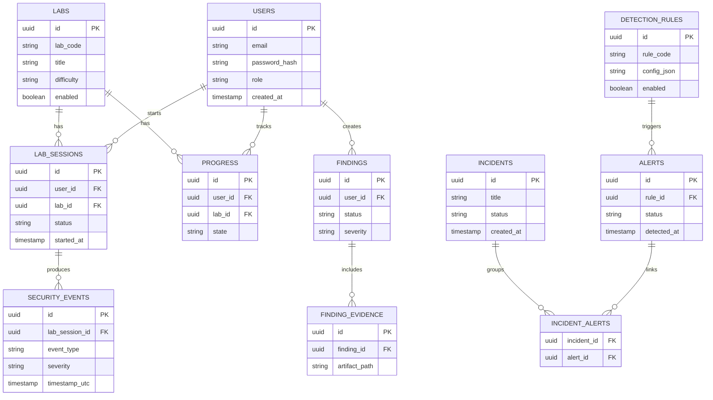

# CyberLab — All-in-One Cybersecurity Learning Platform

> **Project overview & implementation blueprint / Tài liệu tổng quan và thiết kế triển khai**  
> Version / Phiên bản: **1.1 (bilingual planning baseline / bản kế hoạch song ngữ)** · Updated / Cập nhật: **2026-11-06**  
> Project type / Loại dự án: Personal portfolio / educational security lab — Dự án cá nhân / môi trường học an ninh mạng  
> Primary stack / Công nghệ chính: **Java 21 · Spring Boot · React/Vite · PostgreSQL · Docker Compose · GitHub Actions**  
> Target roles / Vị trí hướng đến: **Application Security, Security Engineering, DevSecOps, SOC/Blue Team (entry-level)**

> **Language / Ngôn ngữ:** Tiếng Việt diễn giải theo từng mục; tiếng Anh giữ nguyên ở bản đặc tả, bảng mã FR/API, sơ đồ và lệnh để dễ đối chiếu khi lập trình. / Vietnamese explanations accompany every section; the original English specification and technical identifiers are preserved.

---

## 1. Executive summary / Tóm tắt dự án

**VI — Tổng quan:** CyberLab là nền tảng học an ninh mạng tự triển khai (self-hosted), thiết kế theo module. Dự án kết hợp ứng dụng được lập trình an toàn, các bài lab cố ý có lỗ hổng nhưng được cô lập, quy trình phát hiện → khắc phục → kiểm chứng, thu thập sự kiện và cảnh báo, kiểm tra bảo mật tự động trong CI/CD, đồng thời lưu bằng chứng học tập để làm portfolio GitHub. Đây **không phải** dịch vụ pentest môi trường thật; mọi hoạt động thử nghiệm chỉ áp dụng trên hệ thống thuộc quyền sở hữu hoặc đã được cấp phép rõ ràng.


**CyberLab** is a self-hosted, modular cybersecurity learning platform that combines:

1. a **secure application** demonstrating defensive coding;
2. **intentionally vulnerable exercises** running in isolated, disposable local lab containers;
3. an **attack/defense learning workflow** for reproducing and fixing vulnerabilities;
4. **security event collection, detection, investigation and alerting**;
5. **automated security checks** in CI/CD; and
6. **learning progress and evidence-based reports** to build a credible GitHub portfolio.

This is **not** a production pentesting service or an Internet-facing vulnerable application. All offensive exercises are restricted to environments owned by the developer and explicitly authorized for testing. Vulnerable containers **must not** be exposed publicly.

### 1.1 Problem statement / Vấn đề cần giải quyết

**VI:** Nhiều portfolio mới chỉ có một ứng dụng đăng nhập, một lần chạy scanner hoặc vài bài giải CTF rời rạc. CyberLab kết nối toàn bộ chu trình kỹ thuật: **xây dựng → đánh giá → phát hiện → khắc phục → kiểm chứng → tự động hóa → viết tài liệu** để người học giải thích được cả nguyên nhân và biện pháp phòng thủ.


Many beginner portfolios show only a scanner run, an authentication demo, or a collection of CTF write-ups. CyberLab connects a complete engineering lifecycle: **build → assess → detect → remediate → verify → automate → document**.

### 1.2 Success definition / Định nghĩa thành công

**VI:** Người đánh giá phải có khả năng clone repo, chạy ứng dụng an toàn trên máy cá nhân, bật một bài thực hành đã cô lập, tái hiện lỗi phân quyền trong lab, chuyển sang phiên bản đã vá, chạy test hồi quy và quan sát sự kiện/phát hiện trên dashboard. Các thao tác phải tái hiện được dựa vào README.


At minimum, a reviewer can clone the repository, run the safe core locally, start an isolated exercise, reproduce a documented authorization issue **only within the local lab**, apply or select the fixed implementation, verify the regression test, and see an event and finding in the dashboard.

### 1.3 Explicit non-goals / Những việc ngoài phạm vi

**VI:** Không quét mục tiêu Internet tùy ý, không khai thác hệ thống bên thứ ba, không tự nhận là SIEM/EDR/IASM thương mại hoàn chỉnh, không khẳng định chứng nhận mức độ an toàn và không đưa dịch vụ cố ý chứa lỗ hổng lên Internet. Dự án hướng đến **học tập có kiểm soát và trình diễn có bằng chứng**.


- Scanning unknown Internet targets, unrestricted port scanning, or automatic exploitation of third-party assets.
- Building a production-grade SIEM, EDR, commercial vulnerability scanner, or full enterprise IAM product.
- Claiming the platform can certify an application's security.
- Deploying vulnerable lessons to public cloud hosts.
- Providing realistic attack infrastructure against external systems.

---

## 2. Goals, audience and learning outcomes / Mục tiêu, người dùng và kết quả học tập

**VI:** Các mục tiêu có thể kiểm chứng gồm: học secure coding và kiểm thử quyền truy cập; thực hành ít nhất ba tình huống API có lỗi và cách vá; tự xây ba quy tắc phát hiện có test; tích hợp SAST/SCA/secret scan/image scan; lập một báo cáo sự cố giả lập có timeline; và xuất bản repo có tài liệu, demo, hình ảnh, CI đáng tin cậy. **Bằng chứng** quan trọng hơn số lượng chức năng.


### 2.1 Primary goals / Mục tiêu chính

**VI — Diễn giải các mã G-01…G-06:** G-01: lập trình backend an toàn; G-02: tìm hiểu điểm yếu Web/API trong lab; G-03: phát hiện sự kiện an ninh; G-04: tự động hóa kiểm tra; G-05: điều tra sự cố giả lập; G-06: xây portfolio đủ rõ để phỏng vấn. Bảng tiếng Anh phía dưới nêu minh chứng cụ thể cho từng mục tiêu.


| ID | Goal | Verifiable evidence |
|---|---|---|
| G-01 | Learn secure backend engineering | AuthN/AuthZ tests, threat model, secure code examples |
| G-02 | Learn application/API weaknesses | At least 3 isolated exercises with vulnerable and fixed variants |
| G-03 | Learn detection engineering | Normalized event schema, 3 tested detection rules, alerts |
| G-04 | Learn security automation | CI passing SAST, SCA, secret and image checks |
| G-05 | Demonstrate incident investigation | One documented synthetic incident with timeline |
| G-06 | Build an interview-ready portfolio | Reproducible setup, diagrams, screenshots, short demo, English README |

### 2.2 Intended users and roles / Người dùng và phân quyền

**VI:** **Lab Learner (người học)** đăng nhập, khởi chạy bài lab được phép, theo dõi tiến độ và lưu findings; **Lab Admin (quản trị)** quản lý danh mục lab, vòng đời bài thực hành và quy tắc cảnh báo; **Reviewer (người đánh giá, tùy chọn)** chỉ xem báo cáo demo đã lược bỏ dữ liệu nhạy cảm, không truy cập môi trường dễ bị khai thác. Ngay cả dự án cá nhân vẫn phải kiểm tra quyền ở backend.


- **Lab Learner:** signs in, launches only authorized local exercises, records findings and progress.
- **Lab Admin:** controls lab catalogue, exercise lifecycle, local configuration, detector rules.
- **Reviewer (optional):** can see sanitized demo reports; does **not** receive access to vulnerable services.

For the personal MVP, the same developer may exercise these roles, but permissions must still be enforced server-side.

### 2.3 Learning map / Bản đồ kiến thức

**VI:** Nhóm kỹ năng: **Secure Coding** (validation, xử lý lỗi, đặc quyền tối thiểu); **Identity** (mật khẩu, JWT, MFA); **AppSec** (IDOR/BOLA, BFLA, injection, threat model); **Blue Team** (log, sự kiện, quy tắc cảnh báo); **Security Automation** (SAST, SCA, secret/container scan); **Incident Response** (phân loại, bằng chứng, timeline); **Software Engineering** (REST, PostgreSQL, Docker, test, CI). Các module tương ứng hiển thị trong bảng bên dưới.


| Domain | Concepts | Demonstration |
|---|---|---|
| Secure coding | input validation, output encoding, least privilege, error handling | safe REST endpoints and tests |
| Identity | password hashing, session lifecycle, JWT, refresh rotation, MFA | Module 1 |
| AppSec | BOLA/IDOR, BFLA, mass assignment, injection, threat modeling | Module 2 |
| Blue Team | telemetry, normalization, detection rules, false positives | Module 3 |
| Security automation | SAST, SCA, secrets, container scans, triage | Modules 4–5 |
| Incident response | alert triage, evidence, timeline, postmortem | Module 6 |
| Engineering | REST API, PostgreSQL, Docker, tests, CI, documentation | all modules |

---

## 3. Scope and incremental releases / Phạm vi và các bản phát hành tăng dần

**VI:** Phát triển **modular monolith trước**, không tách microservices khi chưa cần thiết. Đặt bản MVP thật nhỏ, sau đó mở rộng từng phiên bản. Nhãn `v0.1`, `v0.2`, `v0.3`, `v1.0` là **mục tiêu dự kiến**, không phải tuyên bố tính năng đã tồn tại.


### 3.1 MVP (release v0.1) / Phiên bản khả dụng tối thiểu (v0.1)

**VI — Phạm vi:** Spring Boot API + React dashboard + Docker Compose; đăng nhập an toàn và vai trò; trang danh sách lab; script cục bộ do người phát triển chạy để bật/tắt lab; **một** lab BOLA/IDOR chạy riêng biệt với hai biến thể vulnerable/fixed; test chứng minh truy cập chéo tài khoản bị chặn ở bản đã sửa; log sự kiện login thất bại / bị từ chối; trình xem sự kiện và lưu phát hiện đơn giản; README, sơ đồ kiến trúc, quy tắc an toàn. **Tiêu chí nghiệm thu:** lập trình viên khác clone repo và tái hiện toàn bộ quy trình chỉ qua hướng dẫn.


A **modular monolith**, not microservices:

- Spring Boot API and React dashboard with local Docker Compose configuration.
- Register/login (or seeded local accounts), secure credential storage and roles.
- Lab catalogue; local lab start/stop controlled by a trusted developer script (not an unrestricted Docker API exposed to the app).
- **One** isolated BOLA/IDOR exercise with vulnerable and fixed implementations.
- A fixed-case integration test proving unauthorized cross-account access is denied.
- Security event logging for auth failures and access denials.
- A basic event viewer and manual findings report.
- README, setup, architecture diagram and safety guardrails.

**MVP acceptance:** a new developer can follow the README to launch the safe app and intentionally isolated exercise locally, observe a documented finding, then run a passing remediation test.

### 3.2 v0.2 / Bản v0.2

**VI:** Mở rộng lên ba tình huống lỗi quyền truy cập/ghi dữ liệu; thêm quy tắc phát hiện login sai liên tiếp, từ chối quyền nhiều lần, truy cập đối tượng bất thường; xây dashboard cảnh báo, xuất Markdown/JSON, bắt đầu CI cho unit test, integration test, secret scan và dependency scan.


- Three lab scenarios total: BOLA/IDOR, function-level authorization, mass assignment.
- Detection rules for auth failure bursts, repeated access denials and suspicious object access attempts.
- Alerts dashboard, rule test fixtures, report export (JSON/Markdown).
- Initial CI: unit/integration tests, secret scan, dependency scan.

### 3.3 v0.3 / Bản v0.3

**VI:** Thêm SAST, container image scan, quy tắc chặn pipeline (policy gate), có thể tạo SBOM; hoàn thiện TOTP/MFA, rotation và thu hồi refresh token; dựng timeline điều tra sự cố bằng dữ liệu giả lập và bổ sung ảnh minh họa/tài liệu GitHub.


- SAST, container image scan, policy gate, SBOM as an optional deliverable.
- MFA/TOTP, refresh-token rotation, session revocation.
- More structured triage and an incident timeline from synthetic events.
- Documentation and screenshots improved for public GitHub review.

### 3.4 v1.0 / Bản v1.0

**VI:** Sáu module phối hợp ổn định, API rõ ràng, demo và test tái hiện được, threat model có ranh giới tin cậy, cơ chế bảo vệ được kiểm chứng; repo có version/release, video demo, tài liệu quyết định kiến trúc và giới hạn còn tồn tại.


- Six modules integrated with stable APIs, repeatable demos and tests.
- Threat model and documented trust boundaries; security controls validated.
- Versioned releases, demo video, architecture decisions and known limitations.

> The release labels are targets, not guarantees or claims that these features exist already.

---

## 4. Architecture and trust boundaries / Kiến trúc và ranh giới tin cậy

**VI — Kiến trúc:** Người học dùng **React Dashboard** gọi **Spring Boot modular monolith**; backend truy cập PostgreSQL, Redis (tùy chọn), các module Auth, Lab Catalogue, Events/Detection/Alerts. Một CLI cục bộ khởi động lab dễ bị tấn công trong môi trường riêng; chỉ chuyển dữ liệu sự kiện giả lập đã làm sạch qua luồng kiểm soát. **GitHub Actions** chạy các bộ kiểm tra code/dependency/secrets/container. Sơ đồ Mermaid bên dưới giữ nguyên nhãn kỹ thuật tiếng Anh để đồng nhất với source code.




### 4.1 Trust boundaries / Các ranh giới tin cậy

**VI — 5 nguyên tắc:** (1) React chỉ là giao diện, **backend phải xác thực quyền**; (2) database dùng truy vấn tham số hóa, tài khoản ít quyền, bí mật an toàn; (3) safe core và lab vulnerable nằm ở **runtime/network khác nhau**, không chia sẻ Docker socket, secret, dữ liệu thật hay mount host; (4) lab chỉ bind `127.0.0.1`, được khởi chạy chủ động và dọn sạch sau sử dụng; (5) CI chỉ có quyền tối thiểu, secrets ngắn hạn, dữ liệu từ scanner không được xem như chỉ thị để thực thi.


1. **Browser → Backend:** all identity and object permissions are enforced in the backend, not in React.
2. **Backend → Database:** parameterized queries, restrictive DB user and secret management.
3. **Safe core → Vulnerable labs:** **separate runtime and isolated Docker network**; no production secrets, host mounts, Docker socket or sensitive datasets inside labs. Prefer *no direct connectivity* from lab to the safe core. If events are needed, send sanitized fixture events through an explicit controlled ingestion boundary.
4. **Developer workstation → Lab:** only loopback binding (`127.0.0.1`), no public exposure; disposable data and explicit teardown.
5. **CI → Build:** short-lived CI credentials, minimal job permissions; scan findings are reports, never trusted executable instructions.

### 4.2 Recommended architectural decision / Quyết định kiến trúc khuyến nghị

**VI:** Dùng **modular monolith** để giảm độ phức tạp hạ tầng và tập trung vào an ninh mạng. Các feature giao tiếp qua interface/application service trong Java; chỉ tách thành service khi thật sự có nhu cầu cách ly hoặc mở rộng quy mô. **Không đưa Docker API/socket vào endpoint web.**


Begin with a **modular monolith** because the objective is to learn security, not to build distributed systems prematurely. Modules communicate through Java interfaces and application services. Extract a component only when a concrete isolation or scaling requirement emerges.

### 4.3 Suggested top-level components / Các thành phần chính

**VI:** `frontend`: giao diện; `backend`: auth, labs, findings, events, detection; `database`: lưu dữ liệu; `lab-runtime`: khởi tạo/hủy lab cô lập bằng CLI; `security-tools`: gọi công cụ quét và chuẩn hóa báo cáo; `ci`: kiểm thử tự động; `docs`: ghi chép học tập, mô hình đe dọa và bằng chứng. Bảng tiếng Anh phía dưới là quy ước tên kỹ thuật.


| Component | Responsibility | Technology |
|---|---|---|
| `frontend` | Dashboard, labs, events, alerts, reports | React, Vite, TypeScript |
| `backend` | Auth, catalogue, findings, event ingestion, detection | Java 21, Spring Boot 3.x |
| `database` | Users, labs, events, findings, alerts, progress | PostgreSQL |
| `lab-runtime` | Disposable intentionally vulnerable exercises | Docker Compose, local scripts |
| `security-tools` | Scanners and policy wrappers | Semgrep, Trivy, Gitleaks, SCA tool |
| `ci` | Tests and security jobs | GitHub Actions |
| `docs` | Threat models, reports, learning records | Markdown, Mermaid |

---

## 5. Module specifications / Đặc tả 6 module

**VI:** Mỗi module cần có **mục tiêu học tập, chức năng, yêu cầu bảo mật, bài kiểm thử âm tính (negative test) và bằng chứng hoàn thành**. Không coi việc hiển thị giao diện là hoàn thành nếu chưa chứng minh được kiểm soát bảo mật hoạt động đúng.


### Module 1 — Secure Identity & Access / Module 1 — Danh tính, xác thực và phân quyền an toàn

**VI — Mục đích:** Không chỉ làm tính năng login, mà triển khai và hiểu cơ chế **Authentication (xác thực)** và **Authorization (phân quyền)**.

**Yêu cầu chức năng:** `M1-F01` đăng ký/đăng nhập/đăng xuất và chuẩn hóa lỗi; `M1-F02` băm mật khẩu với Argon2id hoặc BCrypt, tuyệt đối không lưu plain text; `M1-F03` áp dụng `LEARNER`/`ADMIN` và kiểm tra quyền sở hữu từng tài nguyên; `M1-F04` access token sống ngắn, rotation/revocation cho refresh token; `M1-F05` giới hạn lần đăng nhập theo tài khoản/IP; `M1-F06` ghi log bảo mật không chứa mật khẩu/token; `M1-F07` (nâng cao) TOTP/MFA, recovery code và quy trình reset an toàn.

**Yêu cầu bảo mật:** cân nhắc cookie `Secure`/`HttpOnly`/`SameSite` và CSRF; không chỉ kiểm tra quyền ở frontend; thông báo lỗi không làm lộ việc tài khoản có tồn tại; lưu secrets qua môi trường hoặc secret manager.

**Kiểm thử nghiệm thu:** mật khẩu sai bị từ chối; không lưu mật khẩu gốc; người học không xem được dữ liệu admin/người khác; refresh token bị thu hồi không sử dụng lại được; log lỗi đăng nhập không ghi dữ liệu nhạy cảm.


**Purpose:** illustrate well-engineered authentication and authorization, not merely working login.

**Functional requirements**

- M1-F01: Register/login/logout with server-side validation and standardized errors.
- M1-F02: Hash and verify passwords with **Argon2id** (preferred if operationally supported) or correctly configured **BCrypt**; never plaintext or reversible encryption.
- M1-F03: Role-based API access for `LEARNER`, `ADMIN`; enforce ownership checks per resource.
- M1-F04: Short-lived access tokens and secure refresh-token lifecycle; use rotation and revocation if refresh tokens are implemented.
- M1-F05: Per-account and per-IP login rate limiting with a sensible lockout/backoff policy.
- M1-F06: Authentication and authorization events without passwords, raw tokens or full sensitive payloads.
- M1-F07 (advanced): TOTP MFA enrollment, recovery-code handling and secure reset process.

**Security requirements**

- Prefer secure, HttpOnly, SameSite cookies when appropriate to the deployment model; evaluate CSRF implications for cookie-based authentication.
- No authorization through frontend checks only; enforce permissions at the service layer.
- No account enumeration via inconsistent public login/reset messages.
- Protect secret keys through environment variables or a secret manager; never commit secrets.

**Acceptance tests**

- Invalid credentials are rejected; passwords are not stored in clear text.
- A learner cannot read admin APIs or another learner's findings.
- A revoked refresh token cannot be reused.
- Auth failure event is emitted without logging the password.

### Module 2 — Vulnerability & Remediation Lab / Module 2 — Bài lab lỗ hổng và khắc phục

**VI — Mục đích:** So sánh hành vi **cố ý có lỗ hổng** và hành vi **đã vá** trong môi trường local tách biệt.

**Danh mục lab:** `LAB-001` BOLA/IDOR (không truy cập đơn hàng người khác); `LAB-002` Broken Function Level Authorization (user thường không gọi hành động admin); `LAB-003` Mass Assignment (DTO chặn ghi thuộc tính được bảo vệ); `LAB-004` (sau) injection (truy vấn tham số hóa); `LAB-005` (sau) rate limiting (giảm tốc khi vượt ngưỡng).

**Hợp đồng cho mỗi lab:** nêu bối cảnh/kiến thức cần có/phạm vi được phép → mục tiêu/threat model → minh họa lỗi trong dữ liệu giả → tái hiện chỉ trên localhost → phân tích nguyên nhân và sửa → chạy regression test → lưu ảnh/test output/write-up đã loại bỏ thông tin nhạy cảm.

**Bắt buộc:** container không privileged, không Docker socket/host mount, không tài khoản hay dữ liệu thật; lab mặc định **tắt**; chỉ bind `127.0.0.1` và teardown sau buổi học; demo public chỉ dùng bản đã sửa hoặc video/báo cáo.


**Purpose:** understand a vulnerability by comparing an intentionally vulnerable variant and a corrected variant in a **local-only** isolated lesson.

**Initial lab catalogue**

| Lab ID | Topic | Expected secure behavior | Evidence |
|---|---|---|---|
| LAB-001 | BOLA / IDOR | User A cannot access User B's order | Negative integration test |
| LAB-002 | Broken Function Level Authorization | Non-admin cannot call admin action | Role test |
| LAB-003 | Mass Assignment | Client cannot set protected fields | DTO allowlist test |
| LAB-004 (later) | Injection risks | Parameterized query prevents injection | Safe repository test |
| LAB-005 (later) | Rate limiting | Excess requests receive throttling | Controlled load test |

**Per-lab learning contract**

1. Scenario, prerequisite concepts and authorized scope.
2. Learning objective and threat model (asset, attacker capability, entry point).
3. Vulnerable behavior in **isolated, disposable test fixtures**.
4. Safe reproduction steps against *localhost only*; no external targets.
5. Root cause and remediation design.
6. Fixed code and automated regression test.
7. Evidence: test output, sanitized screenshot, short write-up.

**Safety enforcement**

- Bind vulnerable service ports only to `127.0.0.1`; apply Docker `internal` networks where practical.
- No privileged containers, Docker socket mounts, or host filesystem mounts.
- Synthetic users/orders/passwords only. No real personal or corporate data.
- Explicit lab enable flag; default **off**.
- Stop and remove lab containers/volumes through a documented teardown command.
- Public demo should show **fixed-only** or recorded evidence, not a live vulnerable endpoint.

### Module 3 — Security Event Monitoring / Mini-SIEM / Module 3 — Giám sát sự kiện bảo mật / Mini-SIEM

**VI — Mục đích:** Biến log thô thành sự kiện có cấu trúc, phát hiện và bằng chứng điều tra.

**Các loại sự kiện chuẩn hóa:** `AUTH_LOGIN_SUCCESS`, `AUTH_LOGIN_FAILURE`, `AUTH_RATE_LIMIT_TRIGGERED`, `ACCESS_DENIED`, `LAB_EXERCISE_STARTED`, `LAB_SUSPICIOUS_OBJECT_ACCESS`, `SECURITY_SCAN_COMPLETED`. Các trường quan trọng gồm ID sự kiện, UTC time, type, severity, actor, source, correlation ID, resource, outcome và metadata đã giới hạn trường.

**Detection rules:** `DR-001` nhiều lần login sai trong cửa sổ thời gian; `DR-002` nhiều lần bị từ chối quyền từ một danh tính; `DR-003` hành vi truy cập object bất thường trong phiên lab.

**Nghiệm thu:** dữ liệu mô phỏng tạo cảnh báo đúng; dữ liệu bình thường hạn chế false positive; xử lý sự kiện trùng idempotent; alert liên kết được đến quy tắc và sự kiện nguồn. Đây là **Mini-SIEM phục vụ học tập**, không phải sản phẩm SOC đầy đủ.


**Purpose:** transform raw app telemetry into usable detection evidence.

**Events (normalized examples)**

- `AUTH_LOGIN_SUCCESS`
- `AUTH_LOGIN_FAILURE`
- `AUTH_RATE_LIMIT_TRIGGERED`
- `ACCESS_DENIED`
- `LAB_EXERCISE_STARTED`
- `LAB_SUSPICIOUS_OBJECT_ACCESS`
- `SECURITY_SCAN_COMPLETED`

**Event fields**: `event_id`, `timestamp_utc`, `event_type`, `severity`, `actor_id` (pseudonym if possible), `source`, `correlation_id`, `resource_type`, `resource_id` (avoid sensitive values), `outcome`, `metadata_json` (allowlisted), `created_at`.

**Detection rules**

- DR-001: Multiple failed logins for the same account over a bounded window.
- DR-002: Repeated authorization denials by a single principal.
- DR-003: Suspicious lab object-access attempts within a session.

**Acceptance tests**

- Synthetic fixtures produce expected alerts.
- Benign fixtures avoid triggering the same alerts where possible.
- Duplicate ingested events are handled idempotently.
- Alerts show rule ID, timestamps and supporting event references.

> A learning Mini-SIEM is not a full SOC platform; explicitly document false positives and detection blind spots.

### Module 4 — Security Scanning & Findings / Module 4 — Quét bảo mật và quản lý phát hiện

**VI — Mục đích:** Tích hợp công cụ có sẵn và xây lớp thu thập/phân tích kết quả, **không mặc định mọi cảnh báo là lỗ hổng đã được xác nhận**.

**Các dạng kiểm tra:** SAST (Semgrep hoặc tương đương) phân tích mã nguồn; SCA (Dependency-Check hoặc tương đương) kiểm tra thư viện phụ thuộc; secret scanning (Gitleaks); image scanning (Trivy). Chuẩn hóa finding theo tool/rule/CVE/severity/vị trí/bằng chứng/trạng thái/thời gian thấy lần đầu và gần nhất.

**Vòng đời finding:** `OPEN` → `TRIAGED` → `FIXED`, hoặc `ACCEPTED_RISK`/`FALSE_POSITIVE` kèm lý do. Phân biệt kết quả mẫu với finding thật, không tuyên bố đã khai thác thành công chỉ vì scanner báo lỗi.


**Purpose:** collect and triage security checks without pretending a tool output is a verified vulnerability.

- SAST: integrate an established analyzer (e.g., Semgrep), keep rules/config versioned.
- SCA: evaluate known issues in dependencies (e.g., OWASP Dependency-Check or another maintained SCA tool).
- Secret scanning: e.g., Gitleaks on repository history/changes according to policy.
- Image scanning: e.g., Trivy for built containers.
- Normalize findings: tool, rule/CVE, severity, file/package, evidence ref, status, first/last seen.
- Workflow states: `OPEN`, `TRIAGED`, `FIXED`, `ACCEPTED_RISK`, `FALSE_POSITIVE`; changes require a rationale.

**Acceptance:** scanner findings and test fixtures are distinguishable; dashboards do not claim an unverified scanner hit was exploited.

### Module 5 — DevSecOps & CI/CD / Module 5 — DevSecOps và CI/CD

**VI — Mục đích:** Đưa kiểm tra bảo mật vào quy trình phát triển hằng ngày. Pipeline đề xuất: **Push/PR → Build + Unit Test → Integration Test → SAST → SCA → Secret Scan → Container Scan → Policy Gate → Báo cáo/Khắc phục**.

**Các nguyên tắc:** GitHub Actions tối thiểu quyền; không in tokens vào log; pin action vào phiên bản tin cậy (tốt nhất commit SHA); phân biệt cảnh báo tham khảo và lỗi phải chặn pipeline, ghi rõ ngưỡng và ngoại lệ; tuyệt đối không triển khai lab dễ bị khai thác lên CI public.


**Purpose:** run security checks as part of ordinary software delivery.

**Suggested pipeline:**



- Principle of least privilege for GitHub Actions permissions.
- Do not print secrets or token values to logs.
- Pin GitHub Actions to trusted versions / ideally commit SHAs.
- Separate informational checks from blocking checks; document thresholds and the rationale for exceptions.
- Never deploy or expose intentionally vulnerable labs in public CI environments.

### Module 6 — Incident Response & Reporting / Module 6 — Ứng phó sự cố và báo cáo

**VI — Mục đích:** Điều tra bằng **sự kiện giả lập** có căn cứ. Tạo incident từ alert; ghép timeline có timestamp và tham chiếu event; ghi nhận đánh giá, phạm vi ảnh hưởng, nguyên nhân, hướng xử lý và biện pháp phòng ngừa; xuất Markdown/JSON đã làm sạch dữ liệu; đính kèm test/bản vá trước khi đóng incident. **Nghiệm thu:** tái hiện được ít nhất một sự cố từ cảnh báo đến báo cáo kết thúc.


**Purpose:** practice evidence-based investigation using **synthetic** events.

- Create incident from one or more alerts.
- Build timestamped timeline with event references.
- Record assessment, impact, root cause, remediation and preventive action.
- Export a Markdown/JSON report with sensitive fields redacted.
- Attach fixed-code/test evidence to close an incident.

**Acceptance:** one complete synthetic case from alert to closure is reproducible with scripted test data.

---

## 6. Functional requirements across the platform / Yêu cầu chức năng toàn hệ thống

**VI — Ý nghĩa độ ưu tiên:** `Must` = bắt buộc, `Should` = nên có, `Could` = tùy chọn. `FR-001…006` thuộc lõi v0.1 (đăng nhập/phân quyền, danh sách lab, tiến độ, CLI lab, ghi finding, xem sự kiện); `FR-007…010` bổ sung phát hiện/cảnh báo, nhập kết quả scanner, xuất báo cáo ở v0.2–v0.3; `FR-011…012` dành cho MFA, quản lý phiên và quy trình incident nâng cao. Bảng mã `FR` tiếng Anh là nguồn tham chiếu cho issue và test.


| ID | Feature | Priority | Target |
|---|---|---|---|
| FR-001 | Login, roles, API permissions | Must | v0.1 |
| FR-002 | List labs and objectives | Must | v0.1 |
| FR-003 | Display progress per lab | Should | v0.1 |
| FR-004 | Launch isolated lab via developer CLI | Must | v0.1 |
| FR-005 | Record finding and remediation evidence | Must | v0.1 |
| FR-006 | View normalized security events | Must | v0.1 |
| FR-007 | Detect threshold-based suspicious events | Should | v0.2 |
| FR-008 | View alerts and investigation history | Should | v0.2 |
| FR-009 | Import normalized scanner reports | Should | v0.2–v0.3 |
| FR-010 | Generate Markdown/JSON security reports | Should | v0.2 |
| FR-011 | MFA and session management | Could | v0.3 |
| FR-012 | Incident workflow and timeline | Could | v1.0 |

### 6.1 Example end-to-end user stories / Ví dụ user story đầu-cuối

**VI:** `US-01`: learner chỉ xem tiến độ/finding của mình; `US-02`: chọn bài lab được phép và đọc mục tiêu; `US-03`: so sánh lỗi và bản sửa trong lab local; `US-04`: nộp finding, chỉ đánh dấu đã khắc phục sau khi test đạt; `US-05`: admin xem sự kiện đã làm sạch và quy tắc đã kích hoạt; `US-06`: developer nhìn CI để biết chính sách bảo mật đạt/trượt vì sao.


- **US-01:** As a learner, I can log in and see only my progress and findings.
- **US-02:** As a learner, I can select an authorized lab and read its learning objective.
- **US-03:** As a learner, I can compare vulnerable versus fixed behavior in a local exercise.
- **US-04:** As a learner, I can submit a finding with evidence and mark remediation verified only after tests pass.
- **US-05:** As an admin, I can view sanitized security events and inspect triggered rules.
- **US-06:** As a developer, I can run a CI pipeline and see why a policy gate passed or failed.

---

## 7. Data model (conceptual) / Mô hình dữ liệu mức khái niệm

**VI:** ERD bên dưới là **bản thiết kế đề xuất**, chưa phải database đã triển khai. Các bảng: `USERS` (người dùng), `LABS` (bài lab), `LAB_SESSIONS` (phiên thực hành), `PROGRESS` (tiến độ), `SECURITY_EVENTS` (sự kiện), `DETECTION_RULES` (quy tắc phát hiện), `ALERTS` (cảnh báo), `INCIDENTS`/`INCIDENT_ALERTS` (sự cố và liên kết), `FINDINGS`/`FINDING_EVIDENCE` (phát hiện và minh chứng). Tên bảng/cột được giữ tiếng Anh để dễ đồng bộ code, migration và SQL.




**Database notes**

- Use UUID primary keys and Flyway migrations.
- `lab_sessions` tracks learning lifecycle, **not** authority to launch arbitrary Docker containers.
- `security_events` should have retention and indexing on `(timestamp_utc, event_type)`; events must not store raw credentials.
- Save evidence through allowlisted server paths or object references, never arbitrary filesystem paths supplied by users.
- Some relationships and columns may evolve after the first implementation; this diagram is conceptual.

---

## 8. Draft REST API contract / Phác thảo hợp đồng REST API

**VI:** API có prefix `/api/v1`. Nhóm `/auth/*` phục vụ đăng ký, đăng nhập, refresh, logout; `/me` trả về hồ sơ; `/labs`/`progress` cho bài thực hành và tiến độ; `/findings` cho kết quả; `/events`, `/alerts`, `/incidents` cho quản trị sự kiện và điều tra; `/reports` xuất báo cáo an toàn. Bảng API phía dưới giữ **method/path** nguyên văn, chỉ định quyền truy cập và mục đích. DTO và quy tắc validation sẽ được chốt khi lập trình.


All protected endpoints are prefixed with `/api/v1`. Exact DTOs and validation rules will be specified during implementation.

| Method | Path | Purpose | Permission |
|---|---|---|---|
| `POST` | `/api/v1/auth/register` | Create learner account | Public (local mode) |
| `POST` | `/api/v1/auth/login` | Authenticate | Public |
| `POST` | `/api/v1/auth/refresh` | Rotate refresh credentials | Authenticated session |
| `POST` | `/api/v1/auth/logout` | Revoke session | Authenticated |
| `GET` | `/api/v1/me` | Profile | Learner/Admin |
| `GET` | `/api/v1/labs` | List available labs | Learner/Admin |
| `GET` | `/api/v1/labs/{labId}` | Lab detail | Learner/Admin |
| `POST` | `/api/v1/labs/{labId}/sessions` | Record locally started lab session | Learner/Admin |
| `GET` | `/api/v1/progress` | My progress | Learner/Admin |
| `POST` | `/api/v1/findings` | Submit finding/evidence metadata | Learner/Admin |
| `GET` | `/api/v1/findings` | My findings (admin all) | Learner/Admin |
| `GET` | `/api/v1/events` | Filter sanitized events | Admin |
| `GET` | `/api/v1/alerts` | List alerts | Admin |
| `POST` | `/api/v1/alerts/{alertId}/triage` | Triage alert | Admin |
| `GET` | `/api/v1/incidents` | Incident index | Admin |
| `POST` | `/api/v1/reports` | Generate sanitized report | Learner/Admin scoped |

### 8.1 API design rules / Quy tắc thiết kế API

**VI:** Xác thực quyền **trên từng object**, không coi ID là bằng chứng được phép truy cập; kiểm tra input ở Bean Validation và service; lỗi chỉ trả thông báo an toàn cùng correlation ID; danh sách phải có phân trang và giới hạn filter; viết OpenAPI cho safe core; **không tạo HTTP endpoint chạy shell command hoặc điều khiển Docker daemon** để bật/tắt lab.


- API authorization is evaluated per object; IDs alone are never proof of access.
- Validate inputs with Bean Validation and service-layer policies.
- Errors return safe messages and a correlation ID; no stack trace or database internals to clients.
- Use pagination and bounded filters on lists, especially events.
- Version API and define OpenAPI/Swagger docs for safe-core endpoints only.
- Lab start/stop happens through **documented local CLI/Compose commands**, not an API that runs arbitrary commands or controls the Docker daemon.

---

## 9. Suggested repository layout / Cấu trúc repository đề xuất

**VI:** Giữ tên file và thư mục **tiếng Anh** để dễ dùng GitHub/CI: `backend` (Spring Boot), `frontend` (React), `vulnerable-labs` (bài lab cố ý có lỗi), `lab-runtime` (script khởi động/dọn dẹp local), `detection-rules`, `security-tests`, `security-tools`, `infra`, `.github/workflows`, `docs`, `scripts`. Cây thư mục bên dưới chỉ là mục tiêu thiết kế, không khẳng định tất cả đã tồn tại.


```text
cyberlab-security-learning-platform/
├── README.md
├── LICENSE
├── .gitignore
├── .env.example                 # placeholder values only
├── backend/
│   ├── pom.xml
│   └── src/
│       ├── main/java/.../cyberlab/
│       │   ├── auth/
│       │   ├── identity/
│       │   ├── labs/
│       │   ├── progress/
│       │   ├── findings/
│       │   ├── events/
│       │   ├── detection/
│       │   ├── incidents/
│       │   ├── common/
│       │   └── config/
│       ├── main/resources/db/migration/
│       └── test/
├── frontend/
│   ├── src/features/
│   │   ├── auth/
│   │   ├── labs/
│   │   ├── events/
│   │   ├── alerts/
│   │   └── reports/
│   └── package.json
├── vulnerable-labs/
│   ├── lab-001-bola/
│   ├── lab-002-bfla/
│   └── lab-003-mass-assignment/
├── lab-runtime/
│   ├── compose.lab.yml
│   └── scripts/                  # local only start/stop/reset
├── detection-rules/
├── security-tests/
├── security-tools/
├── infra/
│   └── compose.core.yml
├── .github/workflows/
├── docs/
│   ├── architecture/
│   ├── adr/
│   ├── threat-models/
│   ├── labs/
│   ├── incident-reports/
│   ├── portfolio/
│   └── security/
└── scripts/
```

### 9.1 Branching and conventions / Quy ước branch và commit

**VI:** Nhánh `main` phải có test/check đạt; tạo nhánh chức năng `feat/...`; dùng Conventional Commits như `feat(auth): ...`, `test(labs): ...`, `docs(threat-model): ...`. Pull request cần mô tả phạm vi, cách test, ảnh nếu thay đổi UI và ảnh hưởng bảo mật.


- `main`: protected, reviewed, passing checks.
- Feature branches: `feat/auth-rbac`, `feat/lab-001`, `feat/detection-rule-001`.
- Commit examples: `feat(auth): add ownership check`, `test(labs): deny cross-user order access`, `docs(threat-model): record lab trust boundary`.
- Each feature PR includes: scope, tests, security impact, screenshots if UI changed, and relevant issue.

---

## 10. Technology stack and alternatives / Công nghệ và lựa chọn thay thế

**VI:** Công nghệ chính: **Java 21 + Spring Boot/Spring Security + React/Vite/TypeScript + PostgreSQL + Flyway + Docker Compose + GitHub Actions**. Có thể thêm Redis để giới hạn request, Testcontainers cho integration test, Semgrep (SAST), Dependency-Check (SCA), Gitleaks (secret scan), Trivy (container scan). **Bảng tiếng Anh** ghi công dụng và phương án thay thế. Chỉ chốt phiên bản tool sau khi kiểm tra tương thích tại thời điểm cài đặt.


| Layer | Default | Why | Alternative |
|---|---|---|---|
| Language | Java 21 | Existing knowledge and LTS ecosystem | Kotlin |
| Backend | Spring Boot 3.x, Spring Security | REST and security integration | Quarkus |
| Frontend | React + Vite + TypeScript | Familiar, fast iteration | Minimal server-rendered UI |
| DB | PostgreSQL | Transactional relational data | H2 for unit tests only |
| DB migration | Flyway | Reproducible schema changes | Liquibase |
| Caching/rate-limit | Redis, optional | Counters and ephemeral state | In-memory for MVP single instance |
| Auth | Spring Security with verified JWT implementation | Learn standard controls | Secure server sessions |
| Tests | JUnit 5, Spring Boot Test, Testcontainers | Repeatable integration tests | Local Compose-only tests |
| CI | GitHub Actions | Public portfolio automation | GitLab CI |
| SAST | Semgrep | Extensible static rules | CodeQL if supported |
| SCA | OWASP Dependency-Check or maintained alternative | Known vulnerable dependencies | Dependabot alerts |
| Secrets | Gitleaks | Detect exposed secrets | GitHub secret scanning |
| Images | Trivy | Container vulnerabilities | Grype |
| Monitoring | App events in PostgreSQL | Lightweight MVP | OpenSearch later |

**Version policy:** verify compatibility and latest stable releases at implementation time; this overview avoids pinning unverified tool versions.

---

## 11. Security requirements and threat model / Yêu cầu an toàn và mô hình đe dọa

**VI:** Threat model phải xác định **tài sản cần bảo vệ → đối tượng/khả năng tấn công → bề mặt tiếp xúc → ảnh hưởng → biện pháp kiểm soát → bằng chứng kiểm thử**. Ưu tiên bảo vệ thông tin đăng nhập, tokens/secrets, dữ liệu người học, độ toàn vẹn log, máy phát triển, Docker daemon và quyền CI.


### 11.1 Assets to protect / Tài sản cần bảo vệ

**VI:** Băm mật khẩu, thông tin MFA, refresh token, key ký ứng dụng; tiến độ và báo cáo học tập; dữ liệu event/alert phải chính xác; máy tính chạy Docker và Docker daemon; secrets và thông tin xác thực trong GitHub Actions. Không đưa tài sản thật vào lab cố ý có lỗ hổng.


- Password hashes, MFA material, refresh tokens and application signing keys.
- User progress and reports.
- Event/alert integrity, because inaccurate telemetry misleads investigation.
- Developer machine and its Docker daemon.
- CI credentials and repository secrets.

### 11.2 Key threats and mitigations / Đe dọa chính và biện pháp giảm thiểu

**VI — Tóm tắt theo bảng:** truy cập trái quyền → kiểm tra quyền sở hữu và negative test; đoán mật khẩu → rate limit/băm mật khẩu/MFA; đánh cắp token → TTL ngắn, thu hồi, lưu trữ an toàn; injection → SQL tham số hóa/validation; log injection → structured log và allowlist; lab public → chỉ loopback/mạng cô lập; Docker socket → không mount vào lab; lộ secrets → quét, che log và xoay khóa; dependency lỗi thời → SCA/image scan/cập nhật; false positive → có bước triage với bằng chứng.


| Threat | Potential impact | Minimum controls |
|---|---|---|
| Broken access control | Cross-user data exposure | ownership checks, negative tests |
| Password guessing | Unauthorized access | throttling, hashing, MFA optional |
| Token theft or reuse | Session hijack | short TTL, revocation, safe storage |
| Injection | Data access or corruption | parameterized SQL, validation |
| Event log injection | Misleading analysis | structured logging, allowlists, encoding |
| Unsafe lab exposure | External exploitation of demo | loopback binding, isolation, no public deployment |
| Docker socket access | Host compromise | never mount socket into a lab |
| Secrets in Git/CI logs | Credential compromise | `.env.example`, scanning, masking, rotation |
| Vulnerable dependency/image | Supply-chain risk | SCA, image scans, updates |
| Scanner false positive | Wasted time, incorrect claims | human triage, evidence, exceptions |

### 11.3 Non-functional requirements / Yêu cầu phi chức năng

**VI:** Hệ thống cần **tái hiện được** (setup/teardown, dữ liệu mẫu cố định), **kiểm thử được** (test cho mỗi quyền quan trọng và detection rule), **dễ bảo trì** (module theo feature, migration, xử lý lỗi thống nhất), **kiểm toán được** (UTC timestamp/correlation ID không lộ secrets), có baseline hiệu năng trước khi đặt KPI, tôn trọng dữ liệu cá nhân và mặc định an toàn: lab nguy hiểm bị tắt, không truy cập public.


- **Reproducibility:** documented local setup and teardown; deterministic sample data.
- **Testability:** at least one automated test for every critical authorization policy and each detection rule.
- **Maintainability:** boundaries by feature package, migration-based DB, consistent error handling.
- **Auditability:** correlation IDs, UTC timestamps and security decisions recorded without secrets.
- **Performance:** reasonable latency for local dashboard; load-test numeric targets only after baseline measurement.
- **Privacy:** synthetic data by default; sanitize logs and reports; explicit retention/deletion policies.
- **Safety:** dangerous exercises cannot be started by default or reached over a public interface.

---

## 12. Development roadmap and milestones / Lộ trình triển khai và cột mốc

**VI:** Ước tính ở mức **10–15 giờ/tuần**, phụ thuộc kinh nghiệm thực tế. **P1 (tuần 1–3):** nền tảng, auth, DB; **P2 (tuần 4–7):** ba lab AppSec và bản vá; **P3 (tuần 8–10):** event, ba quy tắc phát hiện và UI; **P4 (tuần 11–13):** scan tự động, CI policy; **P5 (tuần 14–16+):** sự cố giả lập, báo cáo, tài liệu và demo. Chỉ qua giai đoạn khi tiêu chí nghiệm thu trong bảng đã đạt.


Estimated for **10–15 hours/week**, adjusted to prior Spring Boot knowledge. Durations are illustrative and may change.

| Phase | Weeks | Deliverables | Exit criterion |
|---|---|---|---|
| P1 — Foundation | 1–3 | Repo, backend, frontend, DB, core auth, Compose | Login + roles + test suite pass |
| P2 — AppSec labs | 4–7 | Isolated LAB-001 to LAB-003, fixed variants, reports | Repro + remediation tests pass locally |
| P3 — Detection | 8–10 | Event schema, 3 detection rules, alerts UI | Synthetic fixtures produce expected alerts |
| P4 — Automation | 11–13 | SAST, SCA, secrets/image scanning, security policy | PR pipeline shows pass/fail reason |
| P5 — Incident & portfolio | 14–16+ | Synthetic case report, documentation, demo, release | Reviewer can reproduce full walk-through |

### 12.1 Detailed first 10 development tasks / 10 đầu việc khởi động

**VI — Checklist:** `T01` tạo repo và README; `T02` ghi ranh giới tin cậy và chính sách lab local; `T03` khởi tạo Spring Boot + health endpoint; `T04` PostgreSQL + Flyway + Compose; `T05` bảng users/roles, băm mật khẩu; `T06` xác thực và negative authorization tests; `T07` React dashboard; `T08` seed lab/progress; `T09` LAB-001 với bản vulnerable/fixed; `T10` chứng minh bản fixed từ chối truy cập trái quyền và viết report. Đánh dấu từng ô khi hoàn thành thực tế.


- [ ] T01 — Create public GitHub repo and baseline README.
- [ ] T02 — Document threat boundaries and local-only lab policy.
- [ ] T03 — Bootstrap Spring Boot project and health endpoint.
- [ ] T04 — Add PostgreSQL, Flyway and `compose.core.yml`.
- [ ] T05 — Define `users` and roles; implement password hashing.
- [ ] T06 — Implement authentication plus ownership-level authorization tests.
- [ ] T07 — Scaffold React dashboard and authenticated layout.
- [ ] T08 — Seed lab catalogue and progress entities.
- [ ] T09 — Build isolated LAB-001 with vulnerable/fixed variants.
- [ ] T10 — Demonstrate failed unauthorized access against the fixed variant; document findings.

### 12.2 Definition of Done (for each module) / Tiêu chí hoàn thành mỗi module

**VI:** Mỗi module phải có: mục tiêu và phạm vi rõ, unit/integration test thích hợp, **ít nhất một negative security test**, không có secret thật trong source/log, tài liệu kiến trúc và API được cập nhật, CI đạt hoặc ngoại lệ rủi ro có lý do, setup/teardown chạy được trên môi trường mới, write-up giải thích điều học được và giới hạn. Chỉ đánh dấu hoàn thành sau khi kiểm chứng.


- [ ] Clearly stated learning objective and scope.
- [ ] Unit and relevant integration tests.
- [ ] At least one negative security test.
- [ ] No secrets or sensitive data in commits or logs.
- [ ] Updated architecture/API documentation.
- [ ] Automated checks pass or documented accepted risk exists.
- [ ] Local setup and teardown tested from a clean environment.
- [ ] Short report: what was learned, evidence, limitations.

---

## 13. GitHub portfolio strategy / Chiến lược xây portfolio GitHub

**VI:** README phải giúp người tuyển dụng hiểu dự án trong vài phút: CyberLab giải quyết việc gì, kiến trúc, trạng thái chức năng, cách chạy phần an toàn, cách mở lab có kiểm soát, demo/test và điểm học được. Portfolio tốt nhờ **minh chứng tự làm** (commit, test, report, decision record), không phải số lượng badge hay công cụ.


### 13.1 README home-page sections / Các mục trên README chính

**VI — Thứ tự:** (1) giới thiệu ngắn + động lực; (2) sơ đồ kiến trúc và trust boundaries; (3) checklist **đã làm / dự kiến**; (4) ảnh/GIF bằng dữ liệu giả; (5) quickstart cho safe core và hướng dẫn riêng để bật lab; (6) liên kết bài học/báo cáo; (7) chính sách sử dụng có phép; (8) test, CI badge, giới hạn và roadmap.


1. One-paragraph project pitch + motivation.
2. Architecture diagram and trust boundaries.
3. Feature checklist with **implemented / planned** status.
4. Demo GIF or screenshots using synthetic data.
5. Quickstart for safe core; separate opt-in lab instructions.
6. Learning modules and sample report links.
7. Security policy and authorized usage disclaimer.
8. Tests, CI badge, known limitations and roadmap.

### 13.2 Evidence expected by reviewers / Bằng chứng người đánh giá cần thấy

**VI:** Lịch sử commit tăng dần; test phân quyền có tên dễ hiểu; threat model và phân tích sửa lỗi cho từng lab; pipeline thực sự chạy; ảnh dashboard alert/timeline đã làm sạch; ghi chú false positive, giả định và trade-off. **Không dùng ảnh giả hoặc kết quả test bịa.**


- Commit history showing iterative implementation.
- Automated authorization/regression tests with readable names.
- Threat-model diagram and remediation write-up for each lab.
- CI workflow with practical security checks.
- Sanitized screenshots of alert dashboard and incident timeline.
- Notes on false positives, trade-offs and assumptions.

### 13.3 Example CV description (after implemented) / Ví dụ mô tả trong CV khi đã triển khai

**VI — Mẫu CV (chỉ dùng sau khi có tính năng thật):** *CyberLab — Nền tảng học An ninh mạng tự triển khai: phát triển ứng dụng Java/Spring Boot và React, tích hợp bài lab OWASP API cô lập, xác thực an toàn, phát hiện sự kiện và kiểm tra bảo mật trong CI. Tài liệu hóa quy trình tái hiện → sửa lỗi và viết regression test tự động để xác minh chính sách phân quyền.* Chỉ liệt kê chức năng đã xây và kiểm chứng; thêm số liệu đo được nếu có.


> **CyberLab — Self-hosted Cybersecurity Learning Platform**  
> Built a Java/Spring Boot and React security education platform integrating isolated OWASP API exercises, secure authentication, event detection and CI security checks. Documented attack-to-remediation workflows and implemented automated regression tests to verify authorization controls.

Only include features actually implemented and verified; replace broad statements with measurable outcomes when available.

---

## 14. Risks, dependencies and design trade-offs / Rủi ro, phụ thuộc và đánh đổi thiết kế

**VI:** Những rủi ro cần quản lý: **phình phạm vi** (chỉ ship v0.1 với một lab); **thiết kế quá mức** (ưu tiên modular monolith); **cấu hình lab không an toàn** (loopback, container riêng, quyền tối thiểu); **false positive từ scanner** (triage thủ công); **chép code mà không hiểu** (bắt buộc ghi chú + test); **JWT/session phức tạp** (dùng framework chuẩn); **lộ secrets trong CI** (least privilege); **CV nói quá** (gắn nhãn planned/implemented rõ ràng).


| Risk / trade-off | Why it matters | Response |
|---|---|---|
| Scope creep | Six modules can become unfinishable | Ship v0.1 with one lab and simple events |
| Overengineering | Microservices distract from security | Modular monolith first |
| Vulnerable lab isolation | Could endanger host if misconfigured | Loopback, separate Docker network, no elevated privileges |
| Tool noise / false positives | Untrustworthy results undermine portfolio | Triage and keep evidence; report limitations |
| Learning by copying only | Code may exist without conceptual mastery | Write a learning note and test for each feature |
| Token/session complexity | Easy to introduce new vulnerabilities | Prefer vetted framework defaults, documented decisions |
| CI secrets/permissions | Repository compromise risk | Least privileges, no long-lived secrets where avoidable |
| Misleading project claims | Hurts interview credibility | Label planned features; validate screenshots and tests |

---

## 15. Validation and demo scenarios / Các kịch bản kiểm thử và trình diễn

**VI — Demo A (truy cập an toàn):** A đăng nhập và thử xem finding của B; safe API trả `403` hoặc `404` nhất quán, đồng thời ghi log từ chối đã làm sạch.

**Demo B (vòng học AppSec):** chủ động bật lab local → dùng tài khoản giả để thấy lỗi → chạy phiên bản đã vá → test xác nhận chặn truy cập → lưu nguyên nhân/bằng chứng.

**Demo C (phát hiện/ứng phó):** nạp một chuỗi sự kiện đăng nhập sai giả lập có giới hạn → rule tạo alert → người học xem bằng chứng và đóng incident giả lập.

**Demo D (DevSecOps):** PR kích hoạt test/scan → CI xuất báo cáo làm sạch → minh họa finding được gieo trước và chính sách xử lý.


**Demo A — Secure access**

- Learner A authenticates.
- Learner A tries to access another learner's finding.
- Safe API returns `403` or intentionally consistent `404` and logs a sanitized denial event.

**Demo B — Local AppSec learning loop**

- Explicitly start an isolated lab on localhost.
- Show unauthorized resource access in the intentionally vulnerable lesson with synthetic accounts.
- Switch to or deploy the corrected lesson.
- Run the test that confirms blocked access.
- Submit root-cause analysis and remediation evidence.

**Demo C — Detection and response**

- Inject a bounded synthetic series of failed authentication events.
- Rule engine creates a correlated alert.
- Analyst reviews supporting events, records assessment, and closes a synthetic incident.

**Demo D — DevSecOps policy**

- Pull request triggers tests/scans.
- CI publishes sanitized summaries.
- Demonstrate a pre-seeded test finding and the documented resolution policy.

---

## 16. Operational quickstart (planned commands) / Hướng dẫn chạy nhanh dự kiến

**VI — Cảnh báo:** Lệnh phía dưới là **quy ước dự kiến**, **chưa hoạt động** cho tới khi bạn tạo các file/script tương ứng. `compose.core.yml` chạy ứng dụng an toàn; `start-lab.sh LAB-001` bật bài lab local chủ động; `stop-lab.sh` dọn môi trường; `./mvnw test` chạy kiểm thử.

Các biến `.env` là **giá trị minh họa**, tuyệt đối không dùng `CHANGE_ME_LOCAL_ONLY` hay `SET_WITH_LOCAL_SECRET_GENERATOR` làm mật khẩu thật. Thiết lập ứng dụng phải từ chối placeholder secret ở môi trường ngoài local.


> **Important:** The commands below are proposed conventions. They will work only *after* the described files and scripts have been implemented. This document is the blueprint, not a claim that executable code is already present.

```bash
# Safe core - once implemented
docker compose -f infra/compose.core.yml up --build -d

# Isolated local training lab - explicit opt-in, once implemented
# Ensure lab services bind only to 127.0.0.1
./lab-runtime/scripts/start-lab.sh LAB-001

# Safe exercise teardown - once implemented
./lab-runtime/scripts/stop-lab.sh LAB-001

# Tests - once implemented
cd backend && ./mvnw test
```

Potential sample environment variables (no real secrets):

```dotenv
APP_ENV=local
DB_NAME=cyberlab
DB_USER=cyberlab_local
DB_PASSWORD=CHANGE_ME_LOCAL_ONLY
JWT_SIGNING_KEY=SET_WITH_LOCAL_SECRET_GENERATOR
LABS_ENABLED=false
SECURITY_EVENT_RETENTION_DAYS=30
```

**Never** use the example credentials as a deployed configuration. Implement startup validation to reject placeholder secrets outside local development.

---

## 17. Study plan aligned to building the product / Kế hoạch học song song với triển khai

**VI — Thứ tự học:** Trước **Auth**: OWASP ASVS, AuthN/AuthZ, password hashing → làm login/RBAC và negative test. Trước **Lab**: OWASP API Top 10, threat modeling → làm BOLA/BFLA và write-up vulnerable/fixed. Trước **Detection**: log có cấu trúc, window/threshold, false positive → viết engine và fixture. Trước **Scanning**: SAST/SCA/DAST/CVE/triage → tích hợp adapter và report. Trước **CI**: quyền/secrets của GitHub Actions → policy gate. Trước **Incident**: vòng đời sự cố, bằng chứng/timeline → báo cáo giả lập đầy đủ.

**Phương pháp cho mỗi feature:** đọc khái niệm → tự giải thích mối đe dọa → code ví dụ nhỏ → viết negative test → sửa → chạy lại test → ghi bài học → commit.


| When | Learn first | Then implement | Proof of understanding |
|---|---|---|---|
| Before auth | OWASP ASVS, AuthN vs AuthZ, password hashing | Login, RBAC, ownership checks | Negative tests |
| Before labs | API Security Top 10, risk/threat modeling | Isolated BOLA/BFLA labs | Vulnerable vs fixed write-up |
| Before detection | Log structure, windows/thresholds, false positives | Event ingestion, rule engine | Test fixtures |
| Before scanning | SAST vs SCA vs DAST, CVEs and triage | Scanner adapters | Triage report |
| Before CI | GitHub Actions permissions and secrets | Secure workflow/policy gates | Failing & passing test PR |
| Before incidents | Incident lifecycle, evidence chain and timelines | Incident report feature | Complete synthetic case |

**Recommended learning method for each feature:** read the relevant concept → explain the threat in your own words → implement a minimal example → write a failing negative test → fix the issue → rerun tests → document the result → commit.

---

## 18. Reference standards and documentation / Tiêu chuẩn và tài liệu tham khảo

**VI:** Ưu tiên tài liệu gốc: **OWASP API Security Top 10** (các rủi ro API), **OWASP ASVS** (yêu cầu kiểm tra bảo mật), **WSTG/Cheat Sheet** (hướng dẫn test/phòng thủ), **WebGoat/Juice Shop** (môi trường luyện tập), **Spring Security** (cơ chế framework), **GitHub Actions Security Hardening** (CI), **NIST 800-61** (ứng phó sự cố), **MITRE ATT&CK** (mô hình kỹ thuật tấn công). Kiểm tra phiên bản cập nhật khi triển khai.


Authoritative starting points (consult current versions when implementing):

- [OWASP API Security Top 10 (2023)](https://owasp.org/API-Security/editions/2023/en/0x11-t10/)
- [OWASP Application Security Verification Standard (ASVS)](https://owasp.org/www-project-application-security-verification-standard/)
- [OWASP Web Security Testing Guide](https://owasp.org/www-project-web-security-testing-guide/)
- [OWASP Cheat Sheet Series](https://cheatsheetseries.owasp.org/)
- [OWASP WebGoat](https://github.com/WebGoat/WebGoat)
- [OWASP Juice Shop](https://github.com/juice-shop/juice-shop)
- [Spring Security Reference](https://docs.spring.io/spring-security/reference/)
- [GitHub Actions Security Hardening](https://docs.github.com/en/actions/security-guides/security-hardening-for-github-actions)
- [NIST SP 800-61 Incident Response](https://csrc.nist.gov/pubs/sp/800/61/r3/final)
- [MITRE ATT&CK](https://attack.mitre.org/)

These links are learning references; security requirements should be verified against current project documentation, not assumed from this roadmap alone.

---

## 19. Project completion checklist / Danh sách kiểm tra hoàn thành dự án

**VI — Engineering:** Ứng dụng an toàn chạy từ fresh clone; migration/seed được version hóa; tối thiểu ba bài so sánh vulnerable/fixed có test; quyền thực thi ở backend; test pass trên CI.

**VI — Security:** Không chứa secret/token thật; lab disposable chỉ local và opt-in; threat model ghi rõ tài sản/ranh giới/giả định/biện pháp; scanner result được triage; log/ảnh/báo cáo đã loại thông tin nhạy cảm.

**VI — Learning & Portfolio:** Mỗi lab có mục tiêu, root cause, bằng chứng vá lỗi; ít nhất ba detection rule có test; một sự cố giả lập có timeline/report; README đầy đủ demo/setup/teardown/giới hạn; release notes phân biệt đã làm và dự định.


**Engineering**

- [ ] Safe backend and frontend launch reproducibly from a fresh clone.
- [ ] Database migrations and seed fixtures are versioned.
- [ ] At least 3 secure/unsafe comparisons have automated tests.
- [ ] Least-privilege authorization is enforced by backend.
- [ ] Unit/integration tests are green on CI.

**Security**

- [ ] No hardcoded real credentials, secrets or tokens.
- [ ] Vulnerable labs are disposable, offline/local-only and opt-in.
- [ ] Threat model names assets, boundaries, assumptions and mitigations.
- [ ] Scanner findings are reviewed rather than blindly treated as confirmed vulnerabilities.
- [ ] Logs, screenshots and exported reports are sanitized.

**Learning and portfolio**

- [ ] Each lab has learning objectives, root-cause analysis and fixed-code evidence.
- [ ] At least 3 detection rules have test cases.
- [ ] At least 1 synthetic incident has a complete timeline and report.
- [ ] README includes demo, screenshots, setup, teardown and known limits.
- [ ] Release notes clearly separate shipped features from future plans.

---

## 20. Immediate next step / Bước tiếp theo

**VI:** Bắt đầu **P1/T01–T04**: tạo repository; khởi tạo Java 21 + Spring Boot; dựng PostgreSQL/Flyway; ghi rõ ranh giới giữa safe core và lab có lỗ hổng. **Không** bắt đầu bằng sáu module một lúc và không mở lab ra Internet. Cột mốc GitHub đầu tiên: `v0.1-foundation` — ứng dụng an toàn chạy local, test pass, không có vulnerable endpoint public.


**Start with P1/T01–T04:** create the repo, initialize Spring Boot 3.x with Java 21, create PostgreSQL + Flyway migrations, and document the trust boundary separating the safe core from vulnerable labs. Do not start by implementing all six modules or by exposing vulnerable labs on the Internet.

**First GitHub milestone:** `v0.1-foundation` — safe app starts locally, tests pass, no intentionally vulnerable endpoint is publicly reachable.

---

*This document is a project plan and design specification. It does not represent an already implemented or audited system.*

*Tài liệu này là kế hoạch và đặc tả thiết kế, không có nghĩa hệ thống đã được lập trình, triển khai hay kiểm toán bảo mật.*
